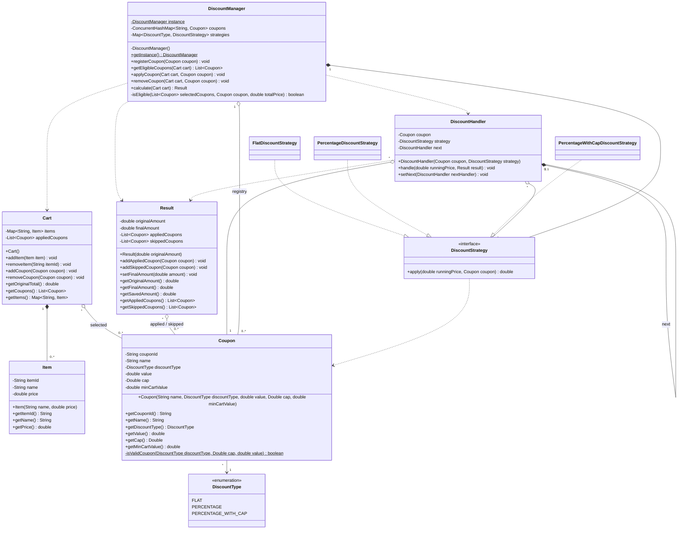
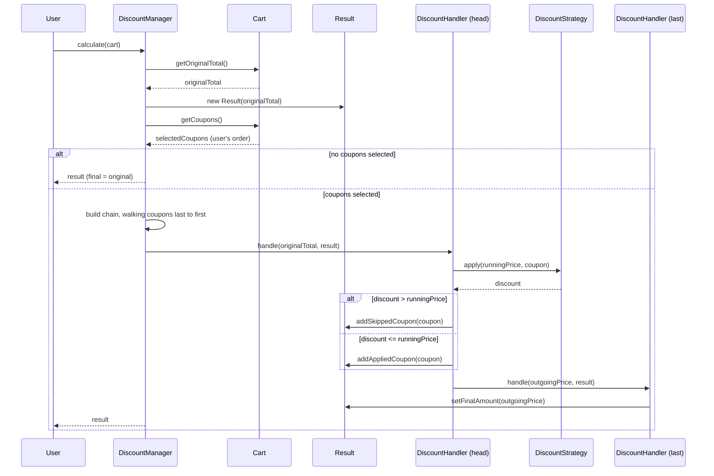

# L14: Discount Coupon Engine

**Patterns:** Strategy + Chain of Responsibility (cumulative variant) + Singleton
**Commit:** `<phase>: discount-coupon-engine - strategy, chain-of-responsibility-cumulative, singleton`

---

## 1. Pattern label change (deviation log)

- The carry-forward listed L14 as **Decorator + CoR + Strategy**. That label was a guess, not verified.
- Search found the most widely circulated version (Coder Army, LLD Lecture 24). From its **video description only** (code and UML not seen), it uses Strategy (Flat, Percentage, Capped Percentage), CoR (coupons apply in sequence, or stop when needed), and Singletons with a central CouponManager. **No Decorator.**
- Following the L9 standing constraint, Decorator was dropped. Decorator count stays at **1** (L13).
- Not verified against the standard: exact class structure, handler layout, whether strategies are shared singletons.
- This is the **cumulative CoR variant**, the one deferred from L13. It differs from L12/L13, where a single handler resolved the request and the chain stopped.

---

## 2. Functional requirements (final)

1. A cart holds items with prices (no inventory or stock tracking).
2. A user can apply and remove eligible coupons.
3. Coupons run in the order the user applied them.
4. Each coupon works on the running price. If a coupon cannot apply, it is skipped and the chain continues.
5. The user gets back the original total, final total, amount saved, applied coupons, and skipped coupons.

**Clarifying questions I'd ask an interviewer:** What makes a coupon eligible? Do coupons apply to the whole cart or to individual items? Can one coupon be used more than once per cart?

**Scoping assumptions (not confirmed by an interviewer):**
- Coupons apply to the whole cart total.
- Types: Flat, Percentage, Percentage with cap.
- One use of a coupon per cart.
- Eligibility is a minimum cart value check.

---

## 3. Key design decisions

| Decision | Choice | Reason / cost |
|---|---|---|
| Ordering policy | **User's apply order** | Simple and predictable. Cost: the user can end up with a worse price, and removing a coupon means recomputing from the original total. |
| Order matters? | Yes (cumulative) | ₹150: flat 100 then 10% gives ₹45. 10% then flat 100 gives ₹35. |
| Coupon cannot apply | **Skip and continue** | My decision, not a verified standard. Stopping the whole chain was rejected. |
| Skip condition | `discount > runningPrice` | A discount exactly equal to the running price is allowed (price becomes 0). |
| Handler count | **One concrete `DiscountHandler`** | Compute behavior differs per type (lives in strategies), but skip/record/forward is identical. Same lesson as L12 (data/behavior in strategy, not in handler subclasses). |
| Strategy contract | `apply(runningPrice, coupon)` returns the **discount amount** | Handler does the subtraction, so the skip rule reads directly. Strategies are stateless and shareable because the coupon is passed in. |
| Manager to strategies | **Composition** (`*--`) | Singleton builds them in its private constructor, they live as long as it does. Handlers only borrow them (aggregation). Other versions may share strategies as separate singletons (aggregation). Both valid. |
| Strategy map | `Map.of` (immutable) instead of `EnumMap` | Safe to share across threads. |
| Handler `next` | Composition | The manager builds a fresh chain on each `calculate()`. Nodes have no life outside the chain and are discarded together. |
| Chain wiring | Walk the coupon list **last to first** | The last handler gets `next = null`, each earlier one is linked to the one built before it, and the final handler held is the head. Nothing is reassigned after wiring. |
| Money type | `double` | Fine for this exercise. Production would use `BigDecimal`. |
| `Coupon` equality | Identity (no `equals` override) | Works because registered coupons are shared instances. Deliberate. |

---

## 4. Eligibility rules

- **Apply-time (original total):** the coupon is registered, not already in this cart, and `originalTotal >= minCartValue`. Checked by one shared helper, `isEligible`, used by both `getEligibleCoupons` and `applyCoupon`.
- **Compute-time (running price):** skip if `discount > runningPrice`. This is separate from the apply-time check.
- Observation: a duplicate apply is rejected by the manager as `CouponNotEligibleException`, so the cart's own `CouponAlreadyExistsException` is unreachable through the manager. Kept deliberately.
- Eligibility details (registered / not-in-cart / min value) are my scoping assumption, not verified against the standard.

---

## 5. Entities

- `DiscountType` (enum): FLAT, PERCENTAGE, PERCENTAGE_WITH_CAP
- `Item`: itemId, name, price
- `Coupon`: couponId, name, discountType, value, cap (nullable `Double`), minCartValue. Validated in the constructor (switch on type; null type, negative value, percentage over 100, and a missing cap for the capped type are rejected).
- `DiscountStrategy` (interface), with `FlatDiscountStrategy`, `PercentageDiscountStrategy`, `PercentageWithCapDiscountStrategy` (uses `Math.min`)
- `DiscountHandler`: coupon, strategy, next. `handle(runningPrice, result)` runs compute, decide (skip or apply), record, then forward-or-finish, with a recursive forward and no loop.
- `Result`: originalAmount, finalAmount (starts equal to the original), applied and skipped lists (unmodifiable getters). `savedAmount` is derived.
- `Cart`: `Map<String, Item>` plus the ordered `List<Coupon>`. Per-user and mutable.
- `DiscountManager`: singleton (double-checked locking, `volatile`), `ConcurrentHashMap` registry, `putIfAbsent` for registration.

---
## 6. Diagrams

**Class diagram (PlantUML):**

**Sequence diagram (calculate):**

---

## 7. Test scenarios (`Main.java`)

| # | Scenario | Result |
|---|---|---|
| 1 | Eligibility on a ₹300 cart (includes boundary: min = total) | EXACT300, FLAT50, SAVE20 eligible. After applying FLAT50, the list shrinks. BIG100 and a duplicate FLAT50 rejected (`CouponNotEligibleException`). |
| 2 | ₹150, flat 100 then 10% | Final ₹45, saved ₹105 |
| 3 | ₹150, 10% then flat 100 | Final ₹35, saved ₹115 (order matters) |
| 4 | ₹110, 10% then flat 100 | Final ₹99, PCT10 applied, FLAT100 skipped, chain continued |
| 5 | ₹400, 20% capped at 30 | Final ₹370 (cap respected) |
| 6 | ₹250, no coupons | Final ₹250, nothing applied or skipped |
| 7 | ₹150, apply two then remove FLAT100 | ₹45, then ₹135 (recomputed from the original) |

- **Hand-trace done before running:** <confirm yes/no, and note any mismatch between your prediction and the output>
- **Scenario 3 printed `[FLAT100, PCT10]`** for the applied list, the reverse of the real order. Cause: the `names()` helper in `Main.java` sorts. Fix: use an order-preserving `orderedNames` for the Result lists. Re-run after applying it, expecting `[PCT10, FLAT100]`.

---

## 8. Bugs caught during development

- `Cart.removeItem` / `removeCoupon` always threw (no `return` after a successful remove).
- Null `cap` caused an NPE in the capped strategy. Fixed by validating in the `Coupon` constructor.
- Strategies initially returned the discounted **price**, not the discount amount. Reverted to the signed-off contract.
- `Result.finalAmount` initialized to 0, so a no-coupon cart showed the whole cart as "saved". Now starts equal to the original.
- `isValidCoupon` parameter order was swapped relative to the call. It compiled because of autoboxing and broke ordinary coupon creation. **Lesson: keep declaration and call argument order identical.**
- `DiscountHandler.handle()` evolved through three rounds: it never wrote to `Result`, then a skip stopped the chain, then the last handler returned before applying its own discount, then the final amount was never set. The last two were the same ordering mistake (deciding "is there a next" before deciding "apply or skip").
- `registerCoupon`: `computeIfAbsent` expects a function, not a value. Use `putIfAbsent`.
- `ConcurrentHashMap.contains(x)` checks **values**, not keys, so it silently rejected every coupon. Use `containsKey`.
- `isEligible` was first called with the registry map instead of the cart's coupon list.
- Off-by-one in the chain-building loop (started at `size()` instead of `size() - 1`).
- Eligibility used `>` instead of `>=`, which rejected a cart that exactly met the minimum.

---

## 9. Exceptions to the usual convention

- I wrote `DiscountHandler.handle()` at review round 3 (normally the person writes pattern classes). The structure was the person's own, with the duplicated forward check merged into one.
- Entity design was completed by the assistant at round 3 after the person asked to stop iterating on it.

---

## 10. Interview talking points

- Why Strategy and CoR are separate: a strategy answers **how** a discount is computed, a handler answers **what happens next** (apply or skip, then forward). They change for different reasons.
- Why one handler class, not one per type (L12 vs. L13 test).
- Why order matters, shown with ₹150 (₹45 vs. ₹35) and the ₹110 skip case.
- Why the chain is rebuilt on every calculation (no reused or mutated chains, no state leaking between requests).
- Why `volatile` in the singleton: it prevents another thread from seeing a half-constructed instance.
- Why `putIfAbsent`: check-then-put is a race even on a `ConcurrentHashMap`.
- Why `double` is wrong for production money.

---

## 11. Open items

- Apply the `orderedNames` fix in `Main.java` and re-run.
- Wrap `Cart.getItems()` in `Collections.unmodifiableMap`.
- Optional: validate `cap >= 0` and `minCartValue >= 0` in `Coupon`.
- If a written source or repo for the standard solution turns up, compare its handler and strategy structure against this one.

---