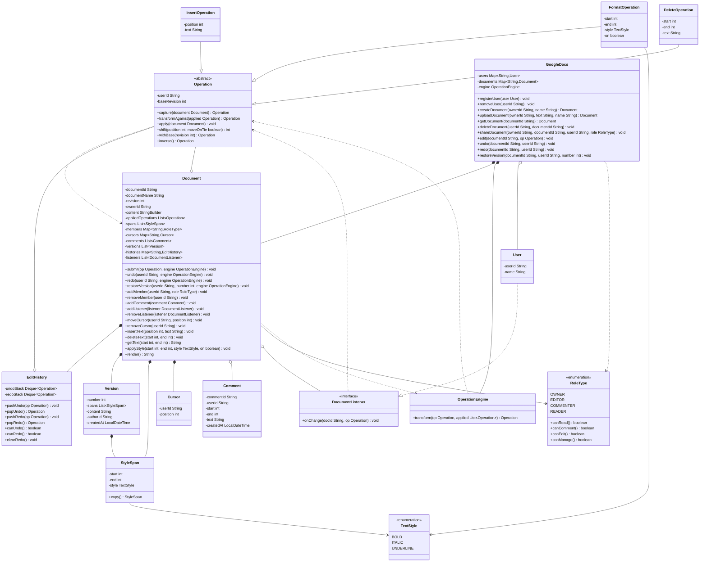

# L19: Google Docs

## What we build and why it matters

A small in-memory Google Docs. Many users edit the same document at the same time, and the text, the formatting, the cursors and the comments stay correct for everyone.

Why it matters: the hard part is not typing, it is two edits that arrive together. A position is only a number, and another user's edit can change what that number means. The design solves this with Operational Transformation (OT), the standard method for this problem. It also gives per-user undo and redo, version history and permissions on top of the same edit log. The same idea is used in real collaborative editors.

## Requirements

1. The system should let a user create a new blank document.
2. The system should let a user upload an existing plain text as a new document.
3. The system should let a user insert text at a position.
4. The system should let a user edit (replace) text. A replace is a delete and an insert.
5. The system should let a user delete text.
6. The system should let the owner delete the whole document.
7. The system should let a user undo and redo their own changes with no limit, and a user's undo must not remove another user's changes.
8. The system should let the owner give a role (editor, commenter, reader) to other users, and remove it.
9. The system should let a user add a comment on a selected part of the text.
10. The system should save a version after every change and let a user restore one.
11. The system should let many users work on the same document at the same time.
12. The system should apply both edits at the right position when two users edit at the same time.
13. The system should delete the content only once when two users delete the same content, and ignore the second delete without an error.
14. The system should refuse any action that the user's role does not allow.
15. The system should keep one cursor per user and move it when other users insert or delete text before it.
16. The system should tell the other users who have the document open when someone changes it.
17. The system should let a user apply bold, italic or underline to a selected part of the text, and remove it.

## Design

**Operations.** Every change is an `Operation` (insert, delete or format). An operation never changes after it is created. The document keeps the applied operations in an ordered log. Each operation has a `baseRevision`: the revision of the document its numbers were made for.

**OT.** When an operation arrives, the engine fixes it against every operation applied after its `baseRevision` (the ones it has not seen). Each operation answers `shift(position, moveOnTie)`, so the engine needs no `if` for each pair of types.

```
log        : [ op0, op1, op2, op3 ]
user edit  : baseRevision = 2
pending    : subList(2, 4) = [ op2, op3 ]
engine     : edit.transformAgainst(op2) -> transformAgainst(op3) -> fixed edit
```

**Roles.** `RoleType` carries its own permissions in constructor values. There is no `switch`.

| Role | read | comment | edit | manage |
|------|------|---------|------|--------|
| OWNER | yes | yes | yes | yes |
| EDITOR | yes | yes | yes | no |
| COMMENTER | yes | yes | no | no |
| READER | yes | no | no | no |

**Class diagram** (getters, setters and exceptions are not drawn):



## Operations

`Document.submit(op, engine)` runs under the document lock (`synchronized`), so one edit at a time per document:

```
1. role check: the user must be a member with canEdit()
2. pending = log entries from op.baseRevision to the end
3. fixed = engine.transform(op, pending)      (null -> ignored, stop here)
4. fixed = fixed.capture(document)            (a delete reads its real text)
5. fixed.apply(document)                      (text or styles change)
6. log.add(fixed), revision++
7. move cursors, comment ranges and style spans with fixed.shift(...)
8. save a Version (content + a copy of the spans)
9. tell every listener
10. push fixed.inverse().withBase(revision) on the user's undo stack, clear redo
```

| Operation | Rule |
|-----------|------|
| Undo | pop the user's undo stack, apply it through the same steps, push its inverse on the redo stack |
| Redo | the same, in the other direction |
| New edit | adds to undo and clears redo |
| Restore version | delete all text, insert the old text, add the old spans, all as normal edits |
| Same range deleted twice | after fixing, the range is empty, so the second edit is ignored |

## Decisions

| Decision | Reason |
|----------|--------|
| OT with position numbers, not a unique id per character | It is the standard design for this problem, and the core stays easy to extend to formatting |
| Operations are immutable (`withBase`, `capture`, `inverse` return new objects) | One operation sits in the log, the undo stack and the redo stack, so sharing must be safe |
| A delete does not take its text from the caller. `capture` reads it after the engine fixes the range | The text can be wrong if the range moved. The constructor with a text is package-private |
| Ties: a cursor and the start of a range move right, the end of a range stays | An insert at the end of a range must not become part of that range |
| `shift` has a `moveOnTie` flag, and only insert uses it | A delete has no tie |
| Undo is per user and has no limit | Requirement 7 |
| One `OperationEngine` for all documents, held by `GoogleDocs` | It has no fields, so it can be shared. It is given to `submit` on each call |
| One `synchronized` lock for each document | Two documents never wait for each other |
| Listeners are called inside the lock | The notifications keep the order of the edits. Listeners must be fast |
| A version is a full copy, and its spans are copied in and out | A saved version must never change |
| Restore is made of normal edits, and it is not put on the undo stack | It uses the same lock, revisions and notifications as every edit |
| A comment stays when its text is deleted, and its range becomes empty | Deleting text should not silently remove someone's comment |
| `OWNER` cannot be given by sharing. Only the owner shares or deletes | One owner for each document |
| `ConcurrentHashMap` for users and documents | Many threads can create documents at the same time |
| Undo of a delete brings the text back but not its bold or italic. Undo of a bold edit removes bold from the whole range | Keeps the model small |
| Positions given by the caller are assumed to be valid | Range checks are out of scope |
| Not built in code: list or download versions, reading a `.txt` file from disk | `uploadDocument` takes the text, and a version keeps its content for later |
| Patterns: Command (an operation with an inverse gives undo and redo), Observer (`DocumentListener`) | No other pattern was needed |

## Results

| # | Scenario | Expected | Result |
|---|----------|----------|--------|
| S1 | Blank document, upload "HELLO" | `""` rev 0, `"HELLO"` rev 1 | OK |
| S2 | Role checks, OWNER role, bad comment range | 7 exceptions, text and revision unchanged | OK |
| S3 | Insert at the end | `"HELLO WORLD"`, rev 2 | OK |
| S4 | Insert at 0 and delete at the end, same base | `"XHELLO WORL"`, rev 3 | OK |
| S5 | Same delete from two users | `"ELLO"`, rev 2, 1 notification | OK |
| S6 | Insert at the end of a deleted range, same base | `"YLO"`, rev 3 | OK |
| S7 | Undo and redo for two users | `"HELLOB"`, `"HELLOAB"`, `"HELLOA"`, rev 6 | OK |
| S8 | New edit clears redo | `"HELLOY"`, rev 4 | OK |
| S9 | Bold, italic, remove bold | three render lines match | OK |
| S10 | Cursor and comment move on insert and delete | 11 and 9-14, 8 and 6-11, 6 and 6-6 | OK |
| S11 | Restore a version, permission and version errors | `"HELLO"`, rev 5 | OK |
| S12 | 10 threads insert with the same base | all 10 letters, rev 10, 10 notifications | OK |

`Wrong lines: 0`
