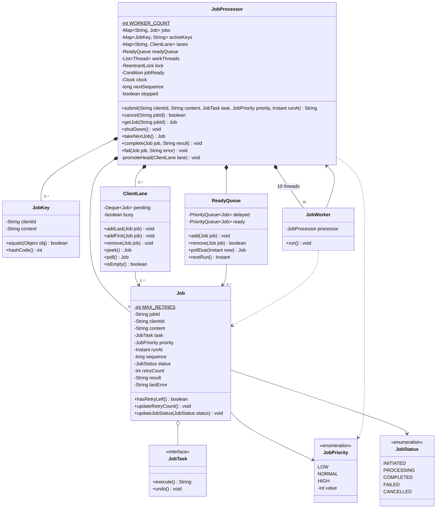

# Job Processing System (L17)

## 1. What we are building and why it matters

**What:** A Job Processing System. A client gives it a job and gets a job id back at once. The system runs the job in the background on one of 10 worker threads, retries it if it fails, and keeps the status and result so the client can look them up later.

**Why it matters:**
- It separates "asking for work" from "doing the work" (producer-consumer). The caller gets a fast answer, and slow work never blocks it.
- It limits the load. A fixed pool of 10 workers means only 10 jobs run at the same time, however many are submitted.
- It keeps order where order matters. Jobs of one client run in the order they were submitted, and different clients run in parallel.
- It handles failure in a safe way. A failed attempt is undone, the job is retried up to 3 times, and then it is kept as Failed.
- It shows safe concurrent updates. One lock protects the shared data, and a Condition lets idle workers sleep instead of looping.
- It shows a clean shutdown. Running jobs finish, new jobs are rejected, and the threads end.
- Real systems with the same idea: background job libraries and message queue consumers (for example Sidekiq, Celery, Quartz, Java's `ExecutorService`). This is general knowledge, not from my search.
- Later case studies in our list, such as Payment Gateway and Food Delivery, are likely to need the same pieces: retry, state changes, and safe concurrent updates.

**Java concepts used:** `Runnable`, `Thread`, `join`, `ReentrantLock`, `Condition` (`await`, `awaitNanos`, `signal`, `signalAll`), `PriorityQueue` with `Comparator`, `ArrayDeque`, `volatile`, and a `HashMap` key with `equals` and `hashCode`.

**Responsibilities**
- Accept jobs from clients and return a job id immediately.
- Run jobs in the background, at most 10 at the same time.
- Keep the jobs of one client in submit order, and let different clients run in parallel.
- Reject a duplicate job (same client and same content) while the first one is still active.
- Run a job at a start time, and pick the job with the highest priority first.
- Undo a failed attempt and retry, up to 3 retries. After that, mark the job Failed.
- Let a client cancel a job that has not started, and look up status and result.
- Stop in a clean way: finish running jobs, accept no new jobs.

**Out of scope:** saving jobs to disk (memory only), repeating jobs (cron style), cancelling a running job, a wait time between retries.

## 2. Requirements

1. The system should accept a job from a client and return a job id immediately, without waiting for the job to finish.
2. The system should let a client look up a job's status and result by job id.
3. The system should run accepted jobs in the background, at most 10 at the same time.
4. The system should run jobs of the same client one after another, in the order they were submitted, even when their priorities are different.
5. The system should run jobs of different clients at the same time.
6. The system should reject a new job if the same client already has a job with the same content in state Initiated or Processing, and return the id of the existing job.
7. The system should let a client set a time for a job to start. The job should not start before that time.
8. When many jobs are ready to run, the system should pick the job with the highest priority first. Between jobs with the same priority, it should pick the oldest first.
9. When a job attempt fails and fewer than 3 retries have been used, the system should undo the changes of that attempt.
10. After undoing, the system should run the job again, before the next job of the same client.
11. When a job fails after 3 retries, the system should mark it Failed, keep it, and print it to the console log.
12. The system should keep these states: Initiated, Processing, Completed, Failed, Cancelled. A job waiting to run again after a failure is Initiated.
13. The system should let a client cancel a job only while it is Initiated. A cancelled job never runs.
14. When the system stops, it should finish running jobs, accept no new jobs, and not run waiting jobs.
15. The system should accept a priority for each job: HIGH, NORMAL or LOW. If the client gives none, the priority is NORMAL.

## 3. Design

### Entities

| Entity | Package | Responsibility |
|---|---|---|
| `JobStatus` | constants | The 5 states of a job |
| `JobPriority` | constants | LOW(1), NORMAL(2), HIGH(3). A bigger value runs first |
| `JobTask` | models | Interface for the client's work: `execute()` returns the result, `undo()` removes the changes of a failed attempt |
| `Job` | models | One unit of work. Fixed data: id, clientId, content, task, priority, runAt, sequence. Changing data: status, retryCount, result, lastError |
| `JobKey` | models | clientId + content. Equal when both are equal. Used to find duplicates |
| `JobProcessor` | core | The entry point. Owns every rule, the one lock, and the 10 worker threads |
| `ClientLane` | core | Keeps the waiting jobs of one client in order, and a `busy` flag |
| `ReadyQueue` | core | Holds the next job of each free client. Two queues: `delayed` and `ready` |
| `JobWorker` | core | A `Runnable`. Asks for a job, runs it, reports the result |
| `InvalidClockException`, `InvalidJobException`, `JobNotFoundException` | exceptions | Errors for wrong input or an unknown job id |

### Class diagram

Getters and setters are not drawn.

### Job states

| From | To | Done by | When |
|---|---|---|---|
| (new) | INITIATED | `submit` | The job is accepted |
| INITIATED | PROCESSING | `takeNextJob` | A worker takes the job |
| PROCESSING | COMPLETED | `complete` | `execute()` returned a result |
| PROCESSING | INITIATED | `fail` | `execute()` failed and retries are left |
| PROCESSING | FAILED | `fail` | `execute()` failed and no retry is left |
| INITIATED | CANCELLED | `cancel` | The client cancels before the job starts |

### Operations

| Operation | What it does |
|---|---|
| `submit(clientId, content, task, priority, runAt)` | Checks the input. Uses NORMAL and "now" as defaults. Returns the id of the active job if it is a duplicate. Otherwise creates the job, adds it to the client's lane, and puts it in the `ReadyQueue` if it is the head of a free lane |
| `takeNextJob()` | Called by a worker. Waits until a job is due. Removes it from its lane, sets the lane busy, sets PROCESSING. Returns `null` after shutdown |
| `complete(job, result)` | Saves the result, sets COMPLETED, removes the key from `activeKeys`, frees the lane, promotes the next job of the client |
| `fail(job, error)` | Saves the error. With retries left: counts the retry, sets INITIATED, puts the job back at the front of its lane. Without: sets FAILED, removes the key, prints a log line. In both cases the lane is freed and the head is promoted |
| `cancel(jobId)` | Only for INITIATED. Removes the job from the lane and the `ReadyQueue`, sets CANCELLED, removes the key. If the job was the head, promotes the next job |
| `getJob(jobId)` | Returns the job. Throws `JobNotFoundException` for an unknown id |
| `shutDown()` | Sets `stopped`, wakes all waiting workers, then waits (`join`) for every worker thread to end |

### How the rules are kept

| Rule | Kept by |
|---|---|
| Req 3: 10 at the same time | The number of worker threads (10) |
| Req 4, 5: client order, clients in parallel | `ClientLane`. Only the head of a free lane is in the `ReadyQueue` |
| Req 6: duplicates | `activeKeys` in `JobProcessor.submit` |
| Req 7: not before the start time | `ReadyQueue.pollDue(now)`: a job moves from `delayed` to `ready` only when `runAt` is not after now |
| Req 8: priority, then oldest | The comparator of `ready`: bigger priority value first, then smaller `sequence` |
| Req 9, 10: undo and retry | `JobWorker` calls `undo()` before `fail`. `fail` puts the job at the front of the lane |
| Req 11: Failed | `JobProcessor.fail` |
| Req 13: cancel | `JobProcessor.cancel` |
| Req 14: stop | `JobProcessor.shutDown` and `stopped` |

### Concurrency

- **One lock** (`ReentrantLock`) in `JobProcessor` protects `jobs`, `activeKeys`, `lanes`, the `ReadyQueue`, and the changing fields of every Job. The lock covers exactly the data one operation changes. `submit`, `complete`, `fail` and `cancel` each change several of these together, so they must not be split into separate locks.
- `execute()` and `undo()` run **outside** the lock, so one slow job does not stop other clients.
- **Waiting:** a worker with no job to run waits on a `Condition` (`jobReady`). `await()` gives the lock back and sleeps. `signal()` wakes one worker. The wait is always inside a `while` loop, because a worker can wake up and find the job already taken.
- **Timed wait:** if a delayed job exists, the worker waits with `awaitNanos(time until the next job)`, so it wakes when the job is due, even if nobody calls `signal()`.
- **Passing the watch:** when a worker takes a job, it calls `signal()` once more. This wakes another worker, which checks the queue again. Without it, the only worker watching the time of a delayed job could take another job, and the delayed job would start late.
- Fields that other threads read without the lock (`status`, `retryCount`, `result`, `lastError`) are `volatile`. `result` is set before the status becomes COMPLETED.

## 4. Decisions

| Decision | Reason |
|---|---|
| One state INITIATED for "waiting" and "waiting for retry". The retry count is a number on the job | A job that will be retried waits to run again, the same as a new job. A separate Retrying state adds nothing |
| Priority levels HIGH, NORMAL, LOW, default NORMAL | The task schedulers I found use priority levels. Chosen by the person |
| Client order wins over priority | Req 4. Priority only decides between jobs of different clients |
| A client's later jobs wait behind an earlier job that has a future start time | Follows from Req 4. Accepted by the person |
| A retried job goes to the front of its lane | The next job of the same client must not run before the retry finishes (Req 10) |
| `undo()` runs before `fail()` | If `fail` ran first, another worker could take the job before the undo is done |
| Duplicate = same clientId and same content, only while the job is Initiated or Processing | After a job is Completed, Failed or Cancelled, the same content can be submitted again |
| Failed jobs are only printed to the console | No file or storage in this case study |
| Memory only, no saved jobs after a restart | The sources I found keep jobs in memory. A database is only named as a distributed extension |
| Worker pool of 10 fixed threads | Set by the person for the case study |
| `ReadyQueue` has two queues: `delayed` (by `runAt`) and `ready` (by priority, then `sequence`) | With one queue sorted by priority, a HIGH job with a future start time would block a LOW job that is due now |
| One lock for everything | Simple and safe. The cost: all submits and finishes wait for each other |
| Test uses the real system clock | `awaitNanos` counts real time, so a fake clock would not wake a sleeping worker |
| A failing `undo()` does not stop the retry. The error text is added to `lastError` | The job still gets its retries |
| A client with no jobs is not removed from `lanes` | A small memory cost, accepted for the case study |
| A running job cannot be cancelled | The system cannot stop code that is already running in a worker |

**Differences from the standard I found:** the sources show one queue with a worker pool. The per-client lane (Req 4, 5) and the duplicate rule (Req 6) are not in those sources. They come from our requirements.
