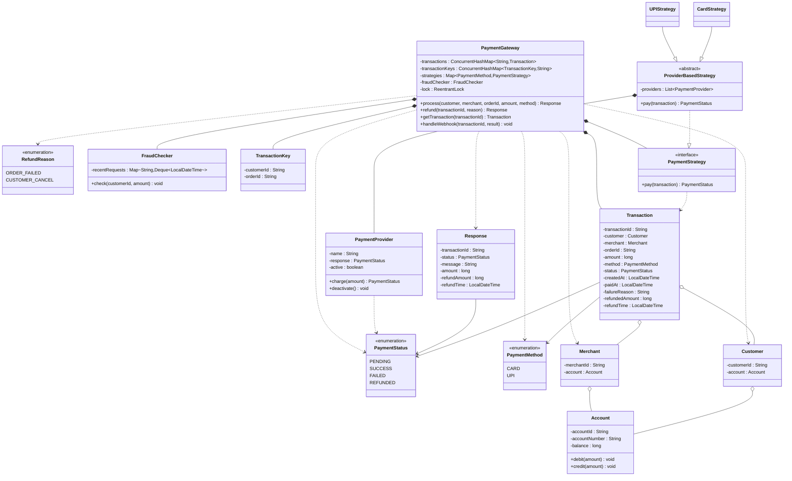

# Payment Gateway (L18)

## 1. What we build and why it matters

A payment gateway sits between the customer and the merchant. It takes a payment request, checks it, asks a provider (a bank or a UPI company) to move the money, and tells the customer the result.

It matters because money is involved. The same request must never charge the customer twice, a failed payment must not keep the money, and a refund must follow clear rules. The design practices three things: one idempotent rule for duplicate requests, a late answer from a provider (webhook), and thread-safe state changes.

## 2. Requirements

The system should:
1. Accept a payment request from a customer for one order and move the money from the customer's account to the merchant.
2. Support payment by card and UPI. Each method can have more than one provider.
3. Pick the provider by a rule.
4. Run a fraud check before the payment goes to a provider. Reject the payment with the reason if the check fails.
5. Reject the payment with a clear reason if the customer does not have enough balance.
6. Allow only one payment at a time for the same customer and the same order. A new request is rejected as duplicate while the old one is pending or already successful. It is allowed only if the old one failed.
7. Accept a webhook: a later message from the provider with the final result of a pending payment, and update the payment.
8. Ignore a webhook for a payment that is not pending, so the same webhook sent twice changes nothing.
9. Refund automatically if money was taken but the order failed.
10. Refund when the customer cancels a paid order. Within 24 hours after the payment: full amount. After 24 hours: half amount.
11. Tell the customer that the refund comes in 1-2 working days.
12. Show the payment status: pending, success, failed, refunded.
13. Return a response for each request. Card: the final result. UPI: "pending" first.

## 3. Design

| Class | Job |
|---|---|
| `PaymentGateway` | Entry point: `process`, `handleWebhook`, `refund`, `getTransaction`. Owns the transactions, the strategies and the fraud checker. |
| `PaymentStrategy` / `ProviderBasedStrategy` | `pay(transaction)`: picks the first active provider of the method. `CardStrategy` and `UPIStrategy` extend it. |
| `PaymentProvider` | A fake bank. Has a name, an `active` flag, and the answer it returns (SUCCESS for card, PENDING for UPI). |
| `FraudChecker` | Rejects an amount above 50,000, or more than 3 requests in the last 1 minute for one customer. |
| `Transaction` | One payment attempt, with its status, paid time and refund data. |
| `TransactionKey` | Customer id + order id. Used to find the old payment for the same order. |
| `Account` | Balance with `debit` and `credit`. Both are synchronized. `debit` throws if the balance is not enough. |
| `Response` | The answer to the customer. Built only with factory methods: `success`, `pending`, `failed`, `refunded`. |

## 4. Class diagram

## 5. Operations

**process**
1. Under the lock: look for an old transaction with the same `TransactionKey`. If it is PENDING or SUCCESS, return a failed response with the old transaction id. Otherwise create the new PENDING transaction and save it in both maps.
2. Outside the lock: fraud check, then balance check. A failure saves the transaction as FAILED with the reason.
3. `strategy.pay(txn)`. FAILED: save the reason. PENDING (UPI): return pending, no money moves. SUCCESS (card): debit the customer, credit the merchant, set the paid time and SUCCESS.

**handleWebhook** (under the lock): only SUCCESS or FAILED are valid results. A transaction that is not PENDING is ignored. SUCCESS moves the money. FAILED saves the reason.

**refund** (under the lock): only a SUCCESS transaction can be refunded, and only once. ORDER_FAILED gives the full amount. CUSTOMER_CANCEL gives the full amount within 24 hours of the paid time, and half after that. The merchant is debited first, then the customer is credited. The refund time is now + 2 days. The status is set to REFUNDED last.

## 6. Decisions

| Decision | Choice | Reason |
|---|---|---|
| Who picks the provider | The gateway, the first active provider of the method | The customer sees only the method. A down provider is skipped. |
| Duplicate rule | Customer + order. Blocked while PENDING or SUCCESS. Allowed after FAILED. | The customer is never charged twice. |
| Lock scope | Only the duplicate check and saving the transaction. Webhook and refund run fully under the lock. | A slow provider call must not stop other customers. A webhook and a refund must not change one transaction at the same time. |
| Money guard | `Account.debit` is synchronized and throws when the balance is not enough | Two payments of one customer can pass the early balance check together. The debit is the real guard. |
| Strategy code | One abstract `ProviderBasedStrategy`. Card and UPI extend it. | The same code is not written twice. Each method keeps its own class for later rules. |
| `Response` | Final fields, built by factory methods | A response cannot be changed or built in a wrong shape. |
| Fraud rate rule | Rejected requests are not counted | A customer who keeps pressing the button is not blocked forever. |
| Webhook | Only for UPI. Card answers at once. | A late answer is the reason for the webhook. |
| Dropped | Currency conversion, timeout, gift card, automatic retry | Removed from the scope by the decision. |
| Defaults | A refunded order can be paid again. Half of an odd amount rounds down. Exactly 24 hours counts as full. If the merchant cannot pay the refund, the refund fails and the status stays SUCCESS. | Not asked, so these are our assumptions. |

## 7. Results

| ID | Scenario | Expected | Result |
|---|---|---|---|
| S1 | Card payment 2000, balance 10000 | SUCCESS, customer 8000, merchant 2000 | Match |
| S2 | Same order again | FAILED duplicate, same transaction id, balances unchanged | Match |
| S3 | Balance 500, pay 1000, two times | Both FAILED, two different ids, balance 500 | Match |
| S4 | Pay 60000 | FAILED, amount above the limit | Match |
| S5 | 4 orders in one minute | SUCCESS, SUCCESS, SUCCESS, FAILED. Customer 99700, merchant 300 | Match |
| S6 | UPI: pending, duplicate, webhook SUCCESS twice | PENDING, balance unchanged, then 4000 and 1000, second webhook changes nothing | Match |
| S7 | UPI webhook FAILED, retry, webhook PENDING | FAILED with reason, balances unchanged, retry PENDING with a new id, invalid result rejected | Match |
| S8 | Refunds | Full refund 1000, second refund rejected, cancel within 24 hours on 1001 gives 1001 | Match |
| S9 | Merchant spent the money, then refund | Refund FAILED, status stays SUCCESS, customer 9000 | Match |
| S10 | 5 threads, same order | 1 SUCCESS and 4 FAILED, customer 9000, merchant 1000 | Match |
| S11 | Unknown transaction id | TransactionNotFoundException | Match |

Result: `Wrong lines: 0`. The half refund after 24 hours cannot be run, because the paid time is always the real time now. It was checked by reading the code.
