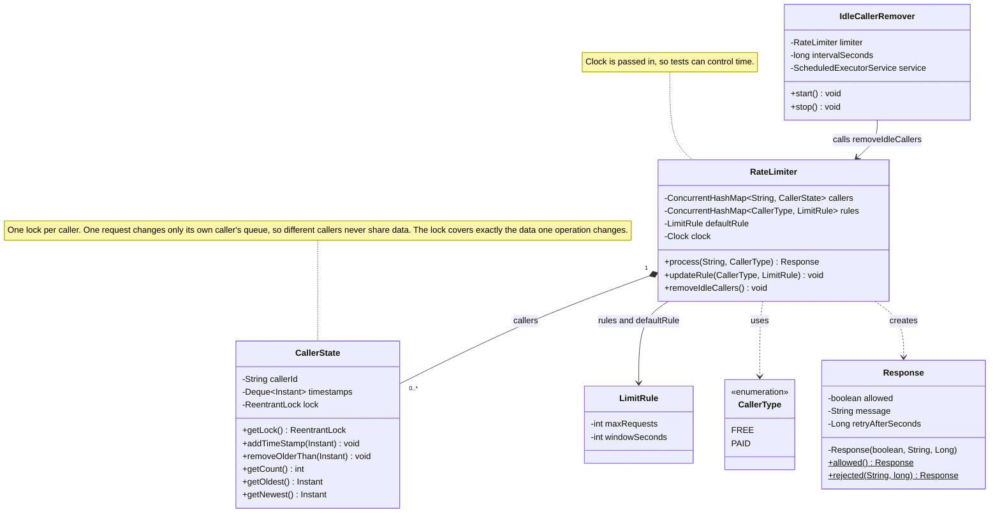

# L16: Rate Limiter

## Requirements

1. The system should allow a caller at most N requests in any period of length T, and reject the rest.
2. The system should identify each caller by a key (user id or API key) and count each caller separately.
3. The system should allow different limits (N and T) for different caller types, with a default limit for types that have none.
4. The system should return a decision for every request: allowed or rejected.
5. When rejecting a request, the system should tell the caller the reason and how many seconds to wait before trying again.
6. When many requests from the same caller arrive at the same moment, the system should never allow more than N. If one slot is left, only one request passes.
7. The system should let an admin change the limit of a caller type while running. The new limit applies from the next request.
8. The system should stop keeping information about callers that have been idle for a long time.

## Design

| Class | Package | Responsibility |
|---|---|---|
| `CallerType` (enum) | constants | Names the caller groups: `FREE`, `PAID` |
| `LimitRule` | models | Immutable rule: `maxRequests` (N), `windowSeconds` (T). Rejects values <= 0 |
| `CallerState` | models | One caller's recent request timestamps (oldest first) and its own lock |
| `Response` | models | Immutable answer: `allowed`, `message`, `retryAfterSeconds` (null when allowed). Created only by `allowed()` and `rejected()` |
| `RateLimiter` | core | Decides allow or reject. Holds the caller map, the rule map, the default rule and the clock |
| `IdleCallerRemover` | core | Background job that calls `removeIdleCallers()` on a fixed interval |

Exceptions: `InvalidRuleException`, `InvalidCallerStateException`, `InvalidCallerTypeException`, `InvalidClockException`.

Algorithm: sliding window log. Each caller keeps the timestamps of its accepted requests. A request is counted only if its timestamp is after `now - T`.

## Class Diagram

## Operations

- `process(callerId, callerType) -> Response`
- `updateRule(callerType, rule)`
- `removeIdleCallers()`
- `IdleCallerRemover.start()` and `stop()`

How `process` works:

1. Reject null `callerType` and null `callerId` with an exception.
2. Get the caller's state with `computeIfAbsent`, and get the rule (or the default rule).
3. Lock the caller's state.
4. Read `now` from the clock, and calculate `boundary = now - T`.
5. Remove timestamps at or before the boundary.
6. If the count is N or more, return rejected with `retry = oldest + T - now`.
7. Otherwise add `now` and return allowed.
8. Unlock in `finally`.

How `removeIdleCallers` works:

1. Take `boundary = now - (largest window among all rules and the default)`.
2. For each caller: lock it, and if its newest timestamp is at or before the boundary, remove it with `remove(key, state)`.
3. Callers with no timestamps yet are left alone.

## Decisions

| Decision | Reason |
|---|---|
| Sliding window log, not a fixed window counter | A fixed window allows up to 2N requests across a window edge. The log counts the exact last T seconds |
| A timestamp exactly at `now - T` is outside the window | The window is (now - T, now], so a request leaves the window exactly T seconds later |
| One lock per caller, around remove, check and add together | Splitting the steps lets two threads both pass the check when one slot is left |
| `now` is read after taking the lock | Timestamps stay in lock order, so the front of the deque is always the oldest |
| Rule is read from the rule map on every request, not stored in the state | An admin change applies from the next request |
| `Clock` is passed in the constructor | Tests can fix the time without waiting |
| `LimitRule` and `Response` are immutable | `updateRule` replaces the rule, so no thread reads a half-changed rule |
| `Response` has a private constructor and two static methods | An invalid mix, like allowed with a retry time, cannot be built |
| The cleaner uses the largest window | A caller idle longer than the largest window is idle for every rule, so removal is safe |
| The cleaner uses `remove(key, state)` | It removes only that exact state, never a newer one |
| `callerId` is the key, not an IP | Callers are identified by user id or API key |
| Retry seconds round down | Kept as it is. A real clock may make a caller retry up to 1 second early and get rejected again |
| The cleaner race is accepted | If a request waits for the lock while the cleaner removes its state, one count is lost. A caller can get N+1 requests once, after a long idle time. It is rare and small |

## Hand Trace

Rules: S1 to S3 and S5 to S8 as listed. `FREE` = 3 per 10 s and `PAID` = 5 per 10 s where used. The default rule is 10 per 5 s.

| Scenario | What it checks | Requests (time: result) | Result |
|---|---|---|---|
| S1 | Limit and window slide | t=0, 1, 2: allowed. t=3: rejected, retry=7. t=10: allowed, then rejected, retry=1 | Match |
| S2 | Boundary burst (12:04:59 and 12:05:01) | 12:04:59 x3: allowed. 12:05:01 x3: rejected, retry=8. 12:05:09: allowed | Match |
| S3 | Callers are separate | u3 x3: allowed. u3 #4: rejected, retry=10. u4 #1: allowed | Match |
| S4 | Different limit per type | PAID #1 to #5: allowed. #6: rejected, retry=10 | Match |
| S5 | Admin changes the rule | Limit 3: allowed x3, then rejected, retry=10. After the change to 5: allowed x2, then rejected, retry=10 | Match |
| S6 | Default rule | PAID with no rule: #1 to #10 allowed. #11 rejected, retry=5 | Match |
| S7 | Cleaner keeps active callers | t=0 x3: allowed. t=5 after cleaner: rejected, retry=5. t=11 after cleaner: allowed | Match |
| S8 | 20 threads, same caller, PAID limit 5 | allowed=5, rejected=15, same in every run | Match |
| S9 | Invalid input | null id, null type, N=0, T=0, null clock | Each throws its own exception |